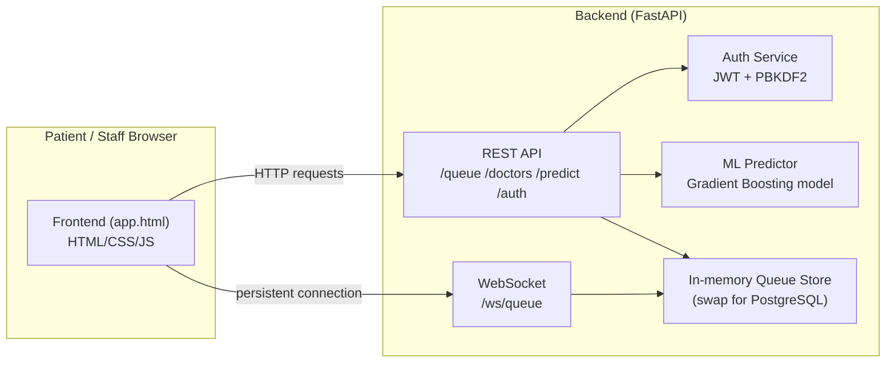

# QueueSense — Interview Preparation Guide
### Hospital Queue & Waiting-Time Predictor

This document is your complete reference for talking about this project in
an interview: why you built it, what's in it, your role, and how to answer
the questions an interviewer is likely to throw at you.

---

## 1. The 30-Second Pitch (memorize this)

> "I built QueueSense, a full-stack system that predicts patient waiting
> time at hospitals using machine learning. Patients register and get a
> live token with an estimated wait; staff manage the queue and doctor
> availability from a real-time dashboard. It has a FastAPI backend, a
> trained regression model for the predictions, JWT-based authentication,
> WebSocket real-time updates, and it's containerized with Docker for
> deployment. I built the entire thing solo, end to end — frontend,
> backend, the ML pipeline, and deployment."

---

## 2. Why I Chose This Project

Use your own words, but the core reasoning:

- **Real, relatable problem.** Everyone has sat in a hospital or clinic not
  knowing if the wait is 10 minutes or 2 hours. It's a problem with obvious
  value, so I didn't have to convince anyone it matters.
- **Touches every layer of a real system**, not just one skill in
  isolation: a frontend patients actually use, an API layer, a trained ML
  model making a real prediction (not just CRUD), authentication, and
  deployment. That breadth is exactly what a first full-stack/software role
  wants to see.
- **Naturally has "why," not just "what."** Wait-time prediction is a
  regression problem with real features (queue size, doctor availability,
  appointment type, time of day) — it's a legitimate small ML project, not
  a toy dataset like Titanic or Iris.

## 3. Real-Life Example (use this to explain it concretely)

> "Say a patient walks into a general outpatient department. The receptionist
> — or the patient themselves — registers them in the system with their name,
> phone number, and appointment type. The system looks at how many patients
> are already waiting, how many doctors are on duty right now, and what kind
> of appointment this is (a routine follow-up takes less time than a new
> specialist consultation), and predicts a wait time — say, 42 minutes. The
> patient can check that estimate on their phone instead of standing in a
> physical queue. As doctors finish with patients or go on break, the
> prediction updates in real time for everyone still waiting. Staff use a
> dashboard to call patients in, mark them done, or toggle a doctor's
> availability, and the whole queue re-calculates immediately."

If asked "would a real hospital actually use this exactly as built?" — be
honest: **this is a working prototype demonstrating the full pipeline**,
not a production deployment. See Section 8 (Limitations) for the honest
list of what's missing for real hospital use — knowing this list well and
being upfront about it is a strength in an interview, not a weakness.

---

## 4. Tech Stack — What, and Why

| Layer | Technology | Why this, specifically |
|---|---|---|
| Frontend | HTML/CSS/JavaScript (vanilla, no framework) | Kept dependency-free and simple to deploy as a single static file (no build step, no npm install needed) — appropriate for the project's scope. If asked "why not React," see Section 7. |
| Backend | FastAPI (Python) | Async-native, automatic OpenAPI/Swagger docs generation, built-in request validation via Pydantic, and it's the modern standard for Python APIs — faster to build and self-documenting compared to Flask. |
| Data validation | Pydantic | Defines the exact shape of every request/response; catches malformed data before it reaches business logic (this is literally what caught a real bug during testing — see Section 6). |
| ML | scikit-learn (Gradient Boosting Regressor) | Compared 3 models (Linear Regression, Random Forest, Gradient Boosting) on MAE; Gradient Boosting won. Explain *why* it won if asked (Section 7). |
| Auth | PyJWT + PBKDF2 password hashing | Real, stateless session tokens (JWT) instead of storing sessions server-side; passwords hashed with salt via Python's built-in hashlib, never stored in plaintext. |
| Real-time | WebSocket (native FastAPI support) | The homepage's live queue monitor uses a persistent WebSocket connection instead of polling — the server pushes updates every 2 seconds rather than the client repeatedly asking. |
| Containerization | Docker + docker-compose | Backend and frontend each have their own Dockerfile; docker-compose runs both together with one command. The backend's Docker build also *retrains the model at build time* to avoid a real bug I hit (Section 6). |
| Deployment targets | Render (backend), Netlify (frontend) | Render runs persistent Python servers (needed for FastAPI); Netlify only serves static files, which is exactly what the frontend is — so the split matches what each platform is actually built for. |

---

## 5. Architecture

**Data flow for a prediction:** frontend sends queue size, doctor count, and
appointment type → FastAPI route → ML predictor loads the trained model →
model predicts wait time → clipped to physically sane bounds (2–180 min) →
returned to frontend.

---

## 6. Real Bugs You Fixed (excellent interview material — use these)

Interviewers love hearing about *actual* problems you hit and solved, not
just "it worked first try." These are true, specific, and show real
engineering judgment:

1. **Unrealistic synthetic training data.** My first version of the
   synthetic dataset produced wait times up to 21 hours because queue size
   and doctor count were generated independently. I fixed it by correlating
   them (more patients → hospitals realistically staff more doctors) and
   capping wait time at 3 hours, reflecting real-world triage. *This shows
   you understand that ML model quality depends on realistic data
   assumptions, not just algorithm choice.*

2. **Model predicting negative wait times.** Gradient Boosting can
   extrapolate outside its training range for rare feature combinations
   (e.g. high-queue emergencies, only 5% of the data). I added a physical
   sanity clip (`max(2, min(prediction, 180))`) because a negative wait
   time is nonsensical regardless of what the model outputs. *This shows
   you don't blindly trust model output — you validate it against
   real-world constraints.*

3. **Pydantic schema type mismatch.** `estimated_wait_minutes` was typed as
   `int`, but the underlying calculation produces decimals (e.g. 7.5
   minutes), causing live 500 errors. Fixed by correcting the type to
   `float`. *Shows attention to type correctness in a typed API.*

4. **scikit-learn version mismatch across environments.** The trained
   model file was pickled with one scikit-learn version and failed to load
   silently (falling back to a heuristic) when run with a different,
   newer version installed locally. This is a **real, well-known MLOps
   problem** — pickled models are tied to the exact library version. I
   fixed it architecturally: instead of shipping a static model file, I
   added a build script that retrains the model fresh using whichever
   library versions are actually installed, and wired it into the Docker
   build process so this can never happen in a proper deployment. *This is
   one of your strongest talking points — it's a genuine production ML
   engineering lesson, not a beginner bug.*

---

## 7. Anticipated Cross-Questions (with strong answers)

### General / Motivation
**Q: Why this project and not something else?**
A: I wanted a project that forced me to build a complete system — frontend,
backend, a real ML model making a real prediction, authentication, and
deployment — rather than a narrow tutorial project. Hospital wait times are
a problem everyone understands immediately, which also makes it easy to
demo and explain.

**Q: What was the hardest part?**
A: Getting the synthetic training data to reflect realistic hospital
behavior — my first attempt produced wait times of over 20 hours because I
hadn't thought about how queue size and doctor staffing are correlated in
real life. Debugging that taught me that ML problems are often data
problems, not algorithm problems.

**Q: What would you do differently if you started over?**
A: I'd design the database schema (real PostgreSQL, not in-memory storage)
from day one instead of retrofitting it later, and I'd write automated
tests alongside each feature instead of testing manually at the end.

### Machine Learning
**Q: Why Gradient Boosting over Random Forest or Linear Regression?**
A: I trained and compared all three on the same data with an 80/20 split.
Linear Regression had the worst performance (R² ≈ 0.79) because the
relationship between queue size, doctors, and wait time isn't purely
linear — congestion effects are non-linear. Random Forest and Gradient
Boosting both performed well (R² ≈ 0.91–0.92); Gradient Boosting won by a
small margin on mean absolute error, so I picked it because the goal was
literally minimizing average prediction error.

**Q: What features did you use, and why?**
A: Queue size, doctors available, appointment type, hour of day, day of
week, an emergency flag, and historical average consultation time. Hour and
day capture congestion patterns (peak hours, weekday vs weekend); emergency
flag and appointment type matter because a specialist consultation takes
longer than a follow-up.

**Q: How did you evaluate the model?**
A: Mean Absolute Error (MAE) and R² on a held-out 20% test split. Final
model: ~9.2 minutes average error, R² of 0.92, on wait times typically
ranging 30–95 minutes.

**Q: Why not a neural network / deep learning?**
A: The dataset is small (thousands of rows, not millions) and tabular with
a handful of interpretable features — this is exactly the regime where
gradient-boosted trees typically outperform deep learning, which needs
much more data to justify its complexity. Simpler, faster to train, and
easier to explain to a non-technical stakeholder (a hospital administrator
isn't going to trust a black-box neural net over a model you can reason
about).

**Q: Your data is synthetic — isn't that a problem?**
A: Yes, and I say so directly rather than hiding it. I don't have access to
real hospital records (understandably — that's sensitive data), so I
generated realistic synthetic data with correlations and noise that mirror
real clinic behavior. The architecture — training pipeline, model
comparison, serving via API — is exactly what you'd do with real data; only
the data source would change.

**Q: How would this model degrade in production, and how would you monitor it?**
A: Real-world drift — for example, seasonal illness spikes changing queue
patterns — would degrade accuracy over time. In production I'd log actual
vs. predicted wait times, track MAE on a rolling window, and retrain
periodically on fresh data, the same way I already separated `train.py`
from the serving code so retraining doesn't require redeploying the API.

### Backend / API Design
**Q: Why FastAPI over Flask or Django?**
A: FastAPI gives automatic request validation (via Pydantic) and
interactive API documentation (Swagger UI at `/docs`) out of the box, is
async-native, and is simply faster to build correct, self-documenting APIs
with less boilerplate than Flask. Django would have been overkill — I don't
need its ORM/admin panel for this scope.

**Q: How does your authentication work?**
A: Passwords are hashed with PBKDF2-HMAC-SHA256 and a random salt per user
— never stored in plaintext. On login, the backend issues a signed JWT
with an 8-hour expiry. Protected routes (staff-only actions) use a FastAPI
dependency that validates the `Authorization: Bearer` header and rejects
missing, malformed, or expired tokens.

**Q: Is your current storage production-ready?**
A: No, and I'm upfront about that — it's an in-memory Python data
structure, which resets on every server restart. I designed the service
layer (`queue_service.py`) so the route handlers never touch storage
directly; swapping in real PostgreSQL means only rewriting that one file's
internals with SQLAlchemy queries, no route changes needed.

**Q: How would you scale this to handle many hospitals / high traffic?**
A: Move off in-memory storage to PostgreSQL with proper indexing on
queue/doctor tables, add a message queue or pub/sub (e.g. Redis) for the
real-time WebSocket layer so multiple backend instances can share state,
and add a `hospital_id` / `department_id` to every table to support
multiple hospitals in the same system rather than one global queue.

**Q: Why WebSocket instead of just polling?**
A: Polling means the client repeatedly asks "anything new?" even when
nothing changed, wasting requests. A WebSocket keeps one persistent
connection and lets the server push updates only when there's something to
send — more efficient, and genuinely real-time instead of "real-time-ish
every few seconds."

### Frontend
**Q: Why not React/Vue instead of plain HTML/CSS/JS?**
A: For this project's scope — a handful of views, no complex client-side
state management — a framework would add build tooling and dependency
overhead without a clear benefit. I can explain component-based thinking
and would use React for a larger app with more complex state, but I made a
deliberate scope-appropriate choice here rather than reaching for a
framework by default.

**Q: How did you handle responsiveness across devices?**
A: CSS Grid/Flexbox with breakpoints (860px, 480px) rather than a
component framework's responsive utilities, mobile-safe-area padding for
notched phones, and a collapsing navigation menu below tablet width.

### DevOps / Deployment
**Q: Walk me through your Docker setup.**
A: Two separate Dockerfiles — one for the FastAPI backend, one for an
nginx container serving the static frontend — tied together with
docker-compose. The backend Dockerfile has an extra step that actually
retrains the ML model during the image build, which guarantees the pickled
model always matches the scikit-learn version installed in that exact
container (see Section 6, bug #4).

**Q: How would you set up CI/CD for this?**
A: GitHub Actions running `pytest` on every push (once tests exist — see
Section 8), then auto-deploying to Render on merge to main via Render's
GitHub integration, and Netlify's own git-based auto-deploy for the
frontend.

### Role / Behavioral
**Q: What was your specific role?**
A: I built the entire project solo — end to end: the frontend UI/UX, the
FastAPI backend and all its routes, the ML pipeline (data generation,
model training, evaluation, serving), authentication, the WebSocket
real-time layer, and the Docker/deployment configuration. If this were a
team project, describe it as "full-stack developer + ML engineer" since
that's genuinely the scope of work involved.

**Q: What did you learn?**
A: That most of the real engineering work in an ML-powered system isn't
the model itself — it's the surrounding system: data realism, serving
infrastructure, environment consistency, and validating model output
against physical/business constraints, rather than the machine learning
algorithm.

---

## 8. Honest Limitations (know this list — it shows maturity, not weakness)

- **In-memory storage** — no PostgreSQL yet; everything resets on restart.
- **Synthetic training data** — not real hospital records.
- **Single queue/department** — no multi-hospital or multi-department support yet.
- **No automated tests** — testing was manual during development.
- **Demo-simple staff accounts** — no email verification or password reset flow.
- **XGBoost not used** — scikit-learn's GradientBoostingRegressor stood in
  for it since xgboost wasn't installable in the development sandbox.

If an interviewer asks "what would you add next," this list *is* your
answer — and naming it unprompted is a good sign of self-awareness.

---

## 9. One More Thing: Know Your Own Numbers

Be ready to say these without hesitation:
- **Model accuracy:** ~9.2 minutes average error, R² of 0.92
- **Models compared:** 3 (Linear Regression, Random Forest, Gradient Boosting)
- **Training data size:** 6,000 synthetic records, 80/20 train/test split
- **Auth:** JWT, 8-hour expiry, PBKDF2-SHA256 password hashing
- **Real-time update interval:** every 2 seconds via WebSocket
